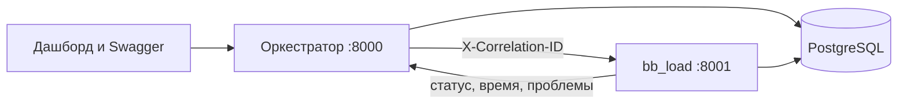

# Risk Process Orchestrator

Прототип оркестратора бизнес-процессов для расчёта рыночных рисков. Он решает две проблемы изолированных микросервисов: **нет сквозной видимости** (невозможно проследить жизненный цикл запроса по шагам) и **сложно управлять процессами** (изменение требует правок сразу в нескольких сервисах).

Оркестратор запускает обработку файла, создаёт сквозной идентификатор `process_id`, передаёт его сервису в заголовке `X-Correlation-ID` и записывает статус и время каждого шага. Всё видно на дашборде.

Расчёт рисков в проект не входит: оркестрируются загрузка, проверка и раскладка данных.

> Статус: **работает сервис `bb_load` и оркестратор**. Сервис `bi_load` будет добавлен по тому же шаблону
## Как это работает



Файл проходит четыре шага: **read** (чтение и проверка структуры), **load** (копия файла в `raw_*`), **validate** (SQL-проверки по правилам), **stage** (чистая таблица `stg_*` с типами). Итоговый статус `OK`, `WARNING` или `ERROR` определяется по худшему шагу автоматически (триггер PostgreSQL).

## Быстрый старт (Windows)

1. Установить Python 3.1x и PostgreSQL. В pgAdmin создать базу `orchestrator`.
2. Выполнить в этой базе по порядку: `db/001_schema.sql`, `db/003_rule_required_when.sql`.
3. Создать окружение и установить зависимости:
   ```
   python -m venv .venv
   .venv\Scripts\activate
   pip install -r requirements.txt
   ```
4. Скопировать `.env.example` в `.env`, вписать пароль PostgreSQL. Для кнопки сброса данных оставить `DEMO_MODE=true`.
5. Запустить всё двойным кликом по `start_all.bat`. Откроются дашборд (`localhost:8000`) и Swagger обоих приложений (`localhost:8000/docs`, `localhost:8001/docs`).
6. В форме на дашборде выбрать таблицу и CSV-файл, нажать «Запустить».

Тестовые файлы без настоящих данных лежат в `demo_data/` (для каждой таблицы по три варианта: `ok`, `warning`, `error`). Создать заново: `python tools/make_demo_files.py`.

Проверка одного файла без сервисов: `python run_file.py cbonds_tradings_stocks demo_data\cbonds_tradings_stocks__ok.csv`.

Тесты (БД не нужна): `python -m unittest discover -s tests -t .`

## Ключевые решения

- **Сквозной `process_id`.** Создаётся оркестратором, передаётся в заголовке, пишется в журнал сервиса и в каждую строку данных. По одному ID собирается вся цепочка.
- **Правила в реестре.** Формат файла и правила для каждого столбца описаны в `rules/bb_load.yaml`; новая таблица добавляется без изменения кода.
- **Проверки в SQL.** Данные загружаются как текст, содержимое проверяется запросами внутри PostgreSQL.
- **Сырая и чистая таблицы.** `raw_*` хранит точную копию файла, `stg_*` только нужные столбцы с типами. Строки с критичными ошибками в чистую таблицу не попадают.
- **Сервис без состояния.** Шаги безопасно повторять; оркестратор не падает, если сервис недоступен.

## Документация

- [Технологический стек](docs/STACK.md)
- [Загрузка и валидация данных](docs/validation.md)
- [Data Lineage: как связаны данные](docs/data-lineage.md)
- [Автоматическое обновление статусов (SQL)](docs/status-logic.md)
- [Узкие места и архитектурные решения](docs/bottlenecks.md)

## Состав репозитория

| Путь | Что внутри |
|---|---|
| `bb_load/` | сервис и его модули: чтение, загрузка, проверка, раскладка |
| `orchestrator/` | оркестратор: запуск процесса, вызов сервиса, запись шагов |
| `rules/` | реестр правил `bb_load.yaml` |
| `db/` | SQL: схема, демонстрация статусов, сброс демо-данных |
| `dashboard.py` | страницы дашборда |
| `run_file.py` | проверка одного файла из командной строки |
| `demo_data/`, `tools/` | синтетические тестовые файлы и их генератор |
| `tests/` | автоматические тесты |
| `docs/` | документация |
| `Диаграммы/` | BPMN-модель процессов |

Реальные выгрузки в репозиторий не добавляются (они принадлежат компании-партнёру).