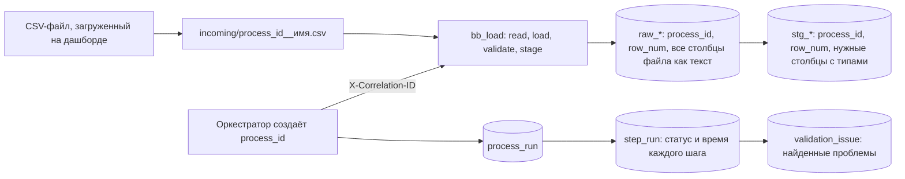

# Data Lineage: как связаны данные

Документ описывает, как по одному идентификатору процесса (`process_id`) проследить путь данных от загруженного файла до строки в чистой таблице и найти все связанные записи: шаги, время, проблемы.

## Три уровня связывания

| Уровень | Что связывается | Чем связано |
|---|---|---|
| Процесс | запуск, его шаги, найденные проблемы | `process_id` в `process_run`, `step_run`, `validation_issue` |
| Данные | исходная копия файла и чистая таблица | `process_id` и `row_num` в `raw_*` и `stg_*` |
| Вызовы | оркестратор и сервис | заголовок `X-Correlation-ID`, запись в журнале сервиса |

## Схема



## Ключи связывания

| Ключ | Где живёт | Как создаётся |
|---|---|---|
| `process_id` (uuid) | `process_run`, `step_run`, `validation_issue`, `raw_*`, `stg_*`, имя файла в `incoming/`, журнал сервиса | оркестратор создаёт при запуске (`gen_random_uuid()` в PostgreSQL) и передаёт сервису в заголовке |
| `row_num` | `raw_*`, `stg_*` | номер записи данных в файле (первая запись после заголовка равна 1). Связывает строку чистой таблицы с исходной |
| `step_id` | `step_run`, `validation_issue` | связывает проблему с шагом, на котором она найдена |

## Что переносится из файла в чистую таблицу

В `raw_*` попадают **все** столбцы файла, значения не меняются. В `stg_*` попадают только столбцы, описанные в реестре (`rules/bb_load.yaml`); остальные проверяются лишь на наличие.

| Таблица | Источник | Разделитель | Столбцов в файле | В `stg_*` | Только наличие | Ключ |
|---|---|---|---|---|---|---|
| `cbonds_tradings_stocks` | cbonds | `$` | 47 | 17 | 30 | `id` |
| `olb_rtsposition` | olb | `;` | 19 | 18 | 1 | `key` |
| `olb_rtsclients` | olb | `;` | 27 | 25 | 2 | `key` |
| `olb_rtscontract` | olb | `;` | 40 | 25 | 15 | `key` |
| `olb_rtsparameters` | olb | `;` | 27 | 16 | 11 | `key` |

Преобразования на пути `raw_*` → `stg_*`:

| Что | Результат |
|---|---|
| пустое значение и слово `None` | `NULL` |
| числа и даты | настоящие типы (`bigint`, `numeric`, `date`, `timestamp`) по реестру |
| значение не подходит по типу в столбце `WARNING` | `NULL`, проблема записана |
| пустое или неверное значение в столбце `ERROR` | строка в `stg_*` не попадает |
| повторяющийся ключ | остаётся первая строка |

## Как проследить данные: запросы

Подставьте нужный `process_id` вместо `'...'`.

Шаги запуска со временем:
```sql
SELECT * FROM v_step_timeline WHERE process_id = '...' ORDER BY step_order;
```

Найденные проблемы:
```sql
SELECT step_id, column_name, severity, issue_type, rows_bad, rows_total
FROM validation_issue WHERE process_id = '...';
```

Из какого файла и для какой таблицы запущен процесс:
```sql
SELECT params->>'table' AS table_name, params->>'file' AS file_name
FROM process_run WHERE process_id = '...';
```

Строка чистой таблицы и её исходная запись:
```sql
SELECT s.row_num, s.isin AS isin_stg, r.isin AS isin_raw
FROM stg_cbonds_tradings_stocks s
JOIN raw_cbonds_tradings_stocks r USING (process_id, row_num)
WHERE s.process_id = '...'
ORDER BY s.row_num LIMIT 10;
```

Строки, которые не попали в чистую таблицу:
```sql
SELECT r.row_num, r.id, r.isin
FROM raw_cbonds_tradings_stocks r
LEFT JOIN stg_cbonds_tradings_stocks s USING (process_id, row_num)
WHERE r.process_id = '...' AND s.row_num IS NULL;
```

Вся цепочка запуска одним ответом: `GET /api/processes/{process_id}` в оркестраторе (Swagger на `/docs`).

## Сквозной идентификатор между сервисами

1. Оркестратор создаёт запись в `process_run` и получает `process_id`.
2. Каждый вызов сервиса содержит заголовок `X-Correlation-ID: <process_id>`.
3. Сервис записывает идентификатор в журнал (`[process_id] шаг=... таблица=...`) и возвращает его в заголовке ответа.
4. Оркестратор сверяет возвращённый идентификатор; при несовпадении шаг получает `ERROR`.
5. Сервис записывает `process_id` в каждую строку `raw_*` и `stg_*`.

## Общий источник в двух сервисах

Таблица `cbonds_tradings_stocks` нужна и `bb_load`, и `bi_load`. Решение: каждый сервис загружает **свою копию** со своим `process_id`, общих таблиц между сервисами нет. Так сервисы остаются независимыми, а lineage каждой копии прослеживается отдельно. Для `bi_load` решение будет применено при его подключении.

## Ограничения

- Lineage на уровне **столбцов** задан реестром (какие столбцы файла попадают в `stg_*`), но не хранится отдельной таблицей в БД.
- Происхождение файла до загрузки (какая внешняя система его выгрузила) не отслеживается: известно только имя загруженного файла.
