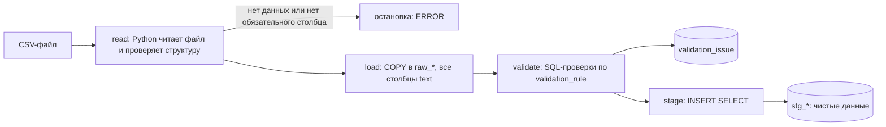

# Загрузка и валидация данных

Документ описывает, как данные проходят путь от файла до очищенной таблицы и кто за какой этап отвечает: **Python** (структура файла) или **SQL в PostgreSQL** (содержимое данных).

## Принцип

> Python знает, **как устроен файл**. SQL знает, **что в нём лежит**.

Python читает файл по настройкам из реестра и передаёт значения в базу **без изменений**. Проверки содержимого выполняются SQL-запросами внутри PostgreSQL. Так в отчёте о проблемах видно, что именно пришло в файле, а не то, что мы уже «исправили».

## Шаги процесса

| Шаг | Что делает | Результат |
|---|---|---|
| `read` | Python читает файл по настройкам из реестра и проверяет структуру | статус по найденным структурным проблемам |
| `load` | Python загружает строки в `raw_*` через `COPY`, все столбцы как текст | сырая копия файла |
| `validate` | SQL проверяет содержимое по правилам из `validation_rule` | записи в `validation_issue`, статус шага |
| `stage` | SQL переносит нужные столбцы в `stg_*` с настоящими типами | чистые данные, число отклонённых строк |

## Схема



## Что делает Python (структура файла)

| Действие | Пояснение |
|---|---|
| Берёт настройки таблицы из реестра | разделитель (`$` или `;`), кодировка, ожидаемое число столбцов |
| Читает файл по этим настройкам | собственный ридер. Сначала обычный разбор CSV (кавычки, переносы строк внутри значений). Если файл выглядит повреждённым, пробуется запасной разбор «обёрнутых» записей и выбирается лучший результат |
| Пропускает пустые строки | в выгрузках встречаются строки без данных |
| Проверяет заголовок и длину строк | сверяет названия столбцов с реестром, отбрасывает записи с неверным числом полей |
| Считает строки | сколько прочитано, пропущено, отклонено. Пишет в `step_run` |
| Загружает данные в `raw_*` через `COPY` | все столбцы как `text`, значения не меняются |

Структурные проблемы записываются в `validation_issue`:

| Тип | Серьёзность | Когда возникает |
|---|---|---|
| `MISSING_COLUMN` | как у столбца в реестре (для «только наличие» это `WARNING`) | в файле нет столбца, описанного в реестре |
| `UNEXPECTED_COLUMN` | `WARNING` | в файле есть столбец, которого нет в реестре |
| `BAD_ROW_LENGTH` | `ERROR` | запись с неверным числом полей |
| `STRAY_QUOTE` | `WARNING` | одиночные кавычки внутри значений (только в запасном режиме разбора) |
| `NO_DATA` | `ERROR` | в файле нет строк данных |

Если нет данных или отсутствует столбец уровня `ERROR`, процесс останавливается: загрузка и SQL-проверки не запускаются.

## Что делает SQL (содержимое)

Запросы собирает модуль `validator.py` по таблице `validation_rule`: для каждого столбца берётся тип, серьёзность и признаки (уникальность, условие обязательности). Пустым считается значение `''` или слово `None`.

| Тип проблемы | Серьёзность | Что проверяется |
|---|---|---|
| `EMPTY` | как у столбца | пустое значение |
| `EMPTY_CONDITIONAL` | как у столбца | пустое значение, но только если выполнено условие (например, тип опциона обязателен только у опционов) |
| `NOT_NUMBER` | как у столбца | значение не является целым или дробным числом |
| `BAD_DATE_FORMAT` | как у столбца | дата не соответствует формату из реестра |
| `DUPLICATE` | `ERROR` | повторяющееся значение уникального ключа |

Результат записывается в `validation_issue`: таблица, столбец, тип проблемы, число плохих строк, число строк всего.

### Пример проверки на пустое значение (упрощённый вид)

```sql
INSERT INTO validation_issue
    (process_id, table_name, column_name, severity, issue_type, rows_bad, rows_total)
SELECT :pid, 'cbonds_tradings_stocks', 'isin', 'ERROR', 'EMPTY',
       count(*) FILTER (WHERE nullif(btrim(isin), '') IS NULL),
       count(*)
FROM raw_cbonds_tradings_stocks
WHERE process_id = :pid
HAVING count(*) FILTER (WHERE nullif(btrim(isin), '') IS NULL) > 0;
```

### Пример проверки типа (упрощённый вид)

```sql
INSERT INTO validation_issue
    (process_id, table_name, column_name, severity, issue_type, rows_bad, rows_total)
SELECT :pid, 'cbonds_tradings_stocks', 'last_price', 'ERROR', 'NOT_NUMBER',
       count(*) FILTER (WHERE nullif(btrim(last_price), '') IS NOT NULL
                          AND btrim(last_price) !~ '^-?\d+(\.\d+)?$'),
       count(*)
FROM raw_cbonds_tradings_stocks
WHERE process_id = :pid
HAVING count(*) FILTER (WHERE nullif(btrim(last_price), '') IS NOT NULL
                          AND btrim(last_price) !~ '^-?\d+(\.\d+)?$') > 0;
```

### Пример проверки дублей ключа

```sql
SELECT id, count(*)
FROM raw_cbonds_tradings_stocks
WHERE process_id = :pid
GROUP BY id
HAVING count(*) > 1;
```

## Реестр правил

Правила описаны в `rules/bb_load.yaml` и при каждом запуске копируются в таблицу `validation_rule`. Модуль `validator.py` читает эту таблицу и собирает проверки автоматически, поэтому новая таблица добавляется описанием в реестре, а не новым кодом.

Режимы проверки столбца:

| Режим | Что проверяется |
|---|---|
| `ERROR` | значение обязательно, его отсутствие или ошибка типа делает шаг `ERROR` |
| `WARNING` | значение желательно, проблема даёт `WARNING` |
| только наличие | проверяется лишь, что столбец есть в файле, значения не анализируются |

Дополнительно для столбца можно задать тип (`integer`, `number`, `date` с форматом), уникальность и условие обязательности.

## Раскладка

После проверки нужные столбцы попадают в `stg_*` с настоящими типами, а к каждой строке добавляются `process_id`, номер строки в файле и время загрузки. По любой строке итоговой таблицы видно, каким запуском она загружена (Data Lineage на уровне строк). Остальные столбцы файла в `stg_*` не переносятся, они остаются только в `raw_*`.

Правила отбора строк:

| Ситуация | Что происходит |
|---|---|
| Пустое значение или `None` | становится `NULL` |
| Значение не подходит по типу в столбце уровня `WARNING` | строка попадает в `stg`, значение становится `NULL` |
| Столбец уровня `ERROR` пуст или не подходит по типу | строка в `stg` не попадает и считается отклонённой |
| Повторяющееся значение уникального ключа | остаётся первая строка, остальные отклоняются |

Таблица `raw_*` остаётся как журнал того, что реально пришло в файле. Число отклонённых строк записывается в `step_run`.

## Статусы

Статус шага определяется по найденным проблемам:

```sql
SELECT CASE
         WHEN EXISTS (SELECT 1 FROM validation_issue
                      WHERE process_id = :pid AND severity = 'ERROR')   THEN 'ERROR'
         WHEN EXISTS (SELECT 1 FROM validation_issue
                      WHERE process_id = :pid AND severity = 'WARNING') THEN 'WARNING'
         ELSE 'OK'
       END AS status;
```

Шаг `stage` получает `WARNING`, если есть отклонённые строки. Статус всего процесса равен **худшему** из статусов его шагов (`ERROR` > `WARNING` > `OK`). Пересчёт выполняется автоматически триггером в PostgreSQL при записи шага.

## Планируется

- Проверка значений-заглушек (например, дата `01.01.1970` у бессрочных фьючерсов): они уже описаны в реестре, но отдельная проверка пока не реализована.

## Разделение ответственности

| Вопрос | Отвечает |
|---|---|
| Какой разделитель, кодировка? | реестр, читает Python |
| Читается ли файл, совпадает ли набор столбцов? | Python |
| Сколько строк в файле? | Python |
| Есть ли пустые значения, неверные типы, дубли? | SQL |
| Какой статус у шага и процесса? | SQL (триггер) |
| Какие столбцы и строки попадают в итоговую таблицу? | реестр, раскладывает SQL |
