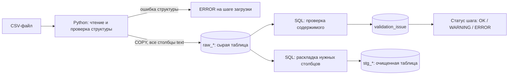

# Загрузка и валидация данных

Документ описывает, как данные проходят путь от файла до очищенной таблицы и кто за какой этап отвечает: **Python** (структура файла) или **SQL в PostgreSQL** (содержимое данных).

## Принцип

> Python знает, **как устроен файл**. SQL знает, **что в нём лежит**.

Python читает файл по настройкам из реестра и передаёт значения в базу **без изменений**. Все проверки содержимого выполняются SQL-запросами уже внутри PostgreSQL. Так в отчёте о проблемах видно, что именно пришло в файле, а не то, что мы уже «исправили».

## Схема



## Что делает Python (структура файла)

| Действие | Пояснение |
|---|---|
| Берёт настройки таблицы из реестра | разделитель (`$` или `;`), кавычки, кодировка, наличие заголовка |
| Читает файл по этим настройкам | собственный ридер, потому что форматы нестандартные (кавычки вокруг записи, переносы строк внутри полей) |
| Пропускает пустые строки | в выгрузках встречаются строки без данных |
| Проверяет число столбцов и заголовок | совпадают ли названия с ожидаемыми, нет ли «съехавших» строк |
| Считает строки | сколько прочитано, сколько пропущено, пишет в `step_run` |
| Загружает данные в `raw_*` через `COPY` | все столбцы как `text`, значения не меняются |

Если файл не удалось прочитать, шаг получает **ERROR**, а SQL-проверки не запускаются.

## Что делает SQL (содержимое)

| Проверка | Серьёзность | Пример |
|---|---|---|
| Пустое значение обязательного столбца | `ERROR` | пустой `isin` |
| Значение не соответствует типу | `ERROR` или `WARNING` | в `last_price` не число |
| Пустое значение необязательного столбца | `WARNING` | пустой `change_365_day` |
| Дубликаты ключа | `ERROR` | повторяющийся `id` |
| Неожиданное значение | `WARNING` | заглушка `01.01.1970` в дате погашения |

Результат каждой проверки записывается в таблицу `validation_issue`: таблица, столбец, тип проблемы, число плохих строк, число строк всего.

### Пример проверки на пустое значение

```sql
INSERT INTO validation_issue
    (process_id, table_name, column_name, severity, issue_type, rows_bad, rows_total)
SELECT :pid, 'cbonds_tradings_stocks', 'isin', 'ERROR', 'EMPTY',
       count(*) FILTER (WHERE nullif(btrim(isin), '') IS NULL),
       count(*)
FROM raw_cbonds_tradings_stocks
WHERE process_id = :pid
HAVING count(*) FILTER (WHERE nullif(btrim(isin), '') IS NULL) > 0;
```

### Пример проверки типа

```sql
INSERT INTO validation_issue
    (process_id, table_name, column_name, severity, issue_type, rows_bad, rows_total)
SELECT :pid, 'cbonds_tradings_stocks', 'last_price', 'ERROR', 'NOT_NUMBER',
       count(*) FILTER (WHERE nullif(btrim(last_price), '') IS NOT NULL
                          AND btrim(last_price) !~ '^-?\d+(\.\d+)?$'),
       count(*)
FROM raw_cbonds_tradings_stocks
WHERE process_id = :pid
HAVING count(*) FILTER (WHERE nullif(btrim(last_price), '') IS NOT NULL
                          AND btrim(last_price) !~ '^-?\d+(\.\d+)?$') > 0;
```

### Пример проверки дублей ключа

```sql
SELECT id, count(*)
FROM raw_cbonds_tradings_stocks
WHERE process_id = :pid
GROUP BY id
HAVING count(*) > 1;
```

## Итоговый статус

Статус шага определяется по найденным проблемам:

```sql
SELECT CASE
         WHEN EXISTS (SELECT 1 FROM validation_issue
                      WHERE process_id = :pid AND severity = 'ERROR')   THEN 'ERROR'
         WHEN EXISTS (SELECT 1 FROM validation_issue
                      WHERE process_id = :pid AND severity = 'WARNING') THEN 'WARNING'
         ELSE 'OK'
       END AS status;
```

Статус всего процесса равен **худшему** из статусов его шагов (`ERROR` > `WARNING` > `OK`). Пересчёт выполняется автоматически функцией и триггером в PostgreSQL при записи шага.

## Как не писать запросы вручную для каждой таблицы

Правила валидации хранятся в реестре (таблица `validation_rule`: таблица, столбец, серьёзность, режим проверки). Функция на PL/pgSQL читает эти правила и собирает проверки автоматически. Поэтому новая таблица добавляется строками в реестре, а не новым кодом.

Режимы проверки столбца:

| Режим | Что проверяется |
|---|---|
| `ERROR` | значение обязательно, его отсутствие или ошибка типа делает шаг `ERROR` |
| `WARNING` | значение желательно, проблема даёт `WARNING` |
| только наличие | проверяется лишь, что столбец есть в файле, значения не анализируются |

## Раскладка

После проверки в `stg_*` копируются только нужные столбцы (остальные отбрасываются по реестру), к ним добавляется `process_id`. По любой строке итоговой таблицы видно, каким запуском она загружена (Data Lineage на уровне строк).

## Разделение ответственности

| Вопрос | Отвечает |
|---|---|
| Какой разделитель, кавычки, кодировка? | реестр, читает Python |
| Читается ли файл, совпадает ли число столбцов? | Python |
| Сколько строк в файле? | Python |
| Есть ли пустые значения, неверные типы, дубли? | SQL |
| Какой статус у шага и процесса? | SQL (триггер) |
| Какие столбцы попадают в итоговую таблицу? | реестр, раскладывает SQL |
